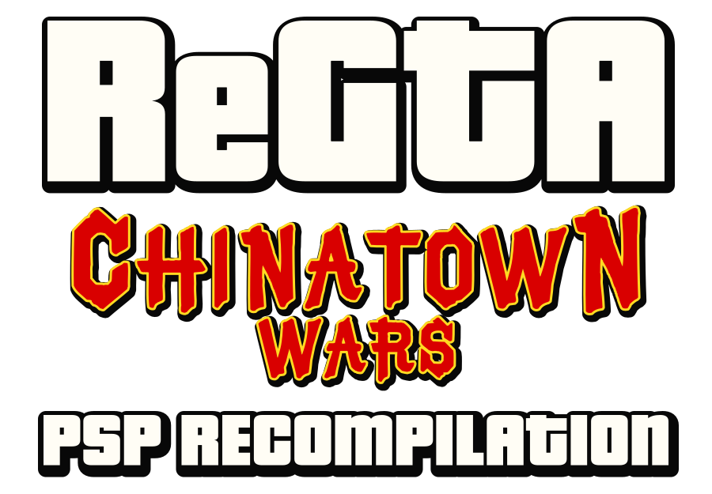
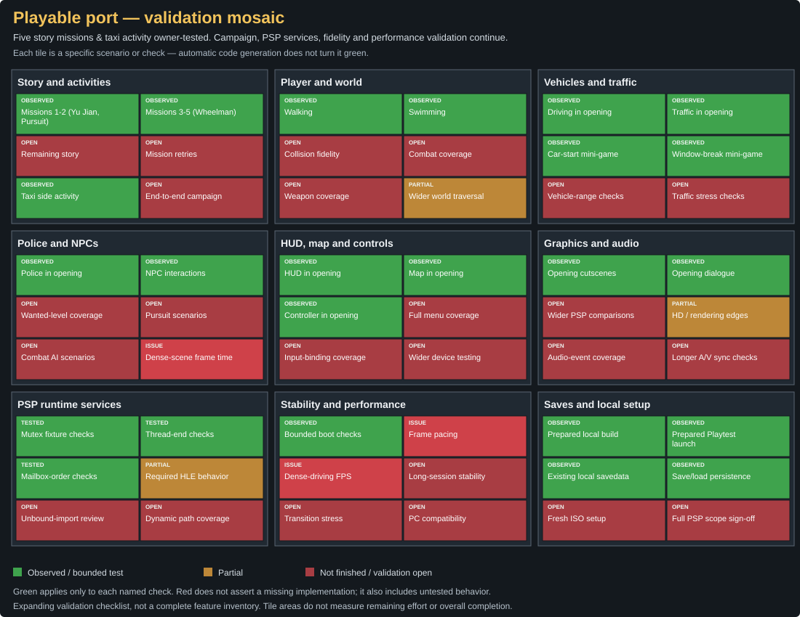
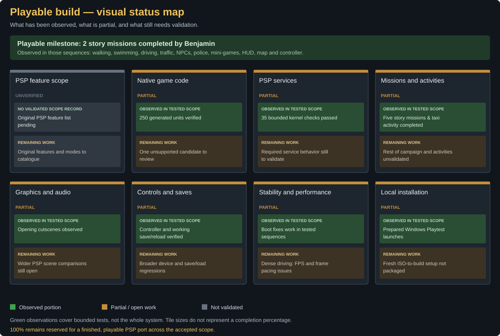

<p align="center"></p>

# ReGTA Chinatown Wars PSP Recompilation — Native port to PC

**The original Chinatown Wars PSP game, recompiled natively for Windows x64.**

C++20 is now the mainline of this independent project by **[Benji Paname (@benji-paname)](https://github.com/benji-paname)**, targeting **PSP Europe ULES-01347 v1.01**. Original MIPS control flow is compiled ahead of time; the runtime provides PSP services, graphics and audio. This is an unfinished native port, not a complete-fidelity certification.

[Website](https://benji-paname.github.io/regta-chinatown-wars-pc-port/) · [Status](docs/STATUS.md) · [Local build](docs/BUILD_CPP.md) · [Playtest guide](docs/PLAYTEST.md) · [Contributing](CONTRIBUTING.md)


## Progress

<!-- CPP_RECOMP_PROGRESS_START -->


[](docs/CPP_PROGRESS.md)

**The playable recompilation is in development. No reliable global completion percentage is available yet.** 100% is reserved for the completed, playable PSP port across its explicitly agreed feature/mode scope, after required services and end-to-end validation pass.

Benjamin has completed the first two story missions in the private Playtest. This is a tested milestone; full campaign coverage, PSP service behavior, stability and performance still need work. [Readiness definition and evidence](docs/CPP_PROGRESS.md).

The mosaic tracks explicit scenarios: **green = observed or tested within the named scope; orange = partial; red = unfinished work or validation still open.** It is an expanding checklist, not a complete feature inventory. Tile sizes do not estimate effort or an overall completion percentage.

[](docs/CPP_PROGRESS.md)

<details>
<summary>Technical diagnostics — generated-code coverage, not finished-port progress</summary>

 

These two badges describe the same static inventory: original-byte-weighted translation coverage and its routine count. Automated generation/compilation is not equivalent to Kryo.to's source-porting workflow and does not establish playable-port completion. [Method and limits](docs/CPP_CODEGEN.md).

[](docs/CPP_CODEGEN.md)

[PSP service bindings — another separate diagnostic](docs/CPP_IMPORTS.md).

</details>
<!-- CPP_RECOMP_PROGRESS_END -->

## Playable progress, with clear limits

**Benjamin reports completing five story missions (up to 'The Wheelman') and a taxi activity in the private PC Playtest using normal controls.** His test covered cinematics/dialogue, walking/swimming, driving/traffic, police/NPC interactions, window-breaking and vehicle-start mini-games, HUD/map, controller input, and verified save/reload persistence. These are observations from tested sequences, not a claim that every system or mission is finished.

The current local validation rebuilt **29 runtime components**, reused **250 generated translation units** covering the executable and **166 overlays**, and passed **35 deterministic kernel checks**. Bink thread-owner cleanup and FIFO/priority handling for mutexes and mailboxes are integrated. Compiler warnings remain; detailed evidence is in the [migration report](docs/CPP_MAINLINE_MIGRATION.md).

**Known limitation:** frame rates can drop toward **20 FPS**, with uneven frametimes, especially while driving through dense traffic and pedestrian areas. Performance and wider campaign validation are the next priorities. No global completion percentage is claimed.

## Your game data stays yours

**No public Playtest download is offered.** A local setup needs your own supported PSP copy and privately generated data. This repository must not contain an ISO/ROM, PSP executable, extracted assets, generated game code, game video/audio, saves or gameplay captures. Existing private files stay on their owner's PC. The public runtime source does not grant rights to the original game content.

Benjamin's existing local package remains in `outputs/ReGTA-CTW-Playtest/`: open **ReGTA-CTW-Playtest.exe** normally, with no command-line setup. Keep its `ms0/` saves and `ctw.ini` preferences. Builds do not replace it automatically. [Private data policy](docs/PRIVATE_DATA.md).

## Development

```powershell
# Check the existing private build recipe and dependencies; no game launch.
.\Compiler.ps1 -Check
# Compile the canonical runtime, link locally and run 35 kernel checks.
.\Compiler.ps1 -Test
```

These commands use the already prepared local Clang/MSVC environment and private generated sources. A fresh public clone is **not** a ready-to-run game; the complete ISO-to-build setup is not yet packaged for public use. See [BUILD_CPP.md](docs/BUILD_CPP.md).

```text
runtime/                    Canonical C++20 runtime, VFPU and SAS sources
 tests/kernel/              Deterministic real-runtime tests
 tools/build/               C++ build entry point and historical Rust builder
 tools/playtest/            Windows launcher source
 docs/                      Website, evidence, build and preservation guidance
 legacy/rust/src/           Preserved historical Rust implementation
 work/                      PRIVATE generation, builds, research and game data
 outputs/ReGTA-CTW-Playtest/ PRIVATE local executable, DLLs, data and saves
```

## Roadmap

1. Profile and improve FPS and frametimes in dense driving scenes.
2. Validate the campaign mission by mission and document regressions.
3. Resolve compatibility issues without guessed PSP behavior.
4. Improve PC usability and packaging.
5. Explore optional mouse-driven mini-games inspired by Android, retaining classic PSP controls when implemented. **This option is planned, not available.**

## Support the work

[Tipeee](https://fr.tipeee.com/benji-paname/) · [PayPal.Me](https://paypal.me/BenjiLsg) · [Discord: benjamin060936](https://discord.com/users/601648068277960714)

Support helps Benjamin spend more time on profiling, reverse engineering, testing and documentation. Donations are voluntary: they do not buy the original game, copyrighted assets, a release date or guaranteed completion.

## Credits, license and history

Built on the PSP recompilation/runtime work of [highcmd](https://github.com/highcmd/chinatown-wars-psp-recomp), with PPSSPP-derived VFPU/SAS components. [Kryo.to's CTW-Native](https://github.com/official-kryo-to/ctw-native) remains the Android reference and informed the historical Rust implementation. Exact provenance and license boundaries: [THIRD_PARTY.md](THIRD_PARTY.md), [runtime/provenance.json](runtime/provenance.json).

Project contributions: GPL-3.0-only; inherited components retain their notices and compatible upstream terms. Game data is separate and not distributed. This fan project is not affiliated with Rockstar Games or Take-Two Interactive. Grand Theft Auto and Chinatown Wars belong to their respective rights holders.

The former Rust port is preserved in [legacy/rust](legacy/rust/) and local branch `legacy/rust-pre-cpp-migration`. Its [historical function inventory](docs/legacy/progress.html) does not describe C++ progress. No historical commits have been rewritten.
