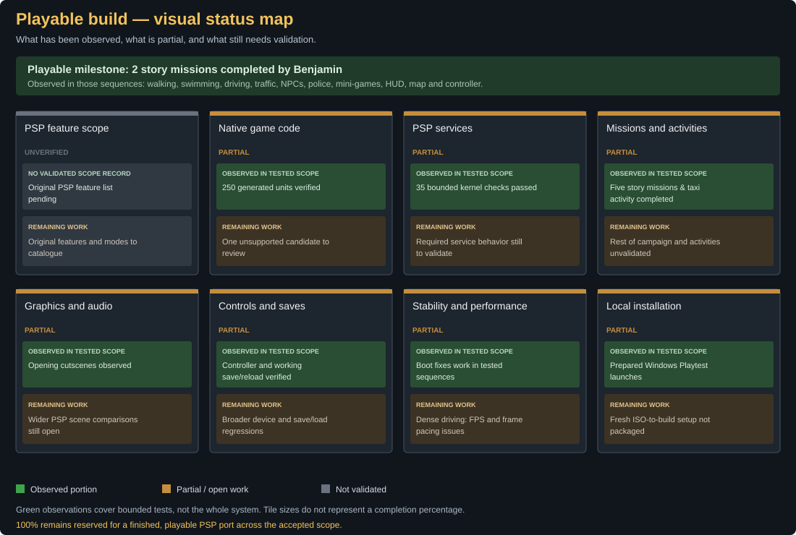

# C++ progress: PSP import source mappings

**80.56% — 203 of 252 selected PSP imports.**

The percentage measures exact `(library, name)` providers in the current canonical C++ source. Each tile is one selected import: green when a provider declaration exists, grey when absent. Providers may be partial or stubs. This metric does not prove correct behavior, multiplayer availability or completion of any percentage of the game.

The private European import inventory contains 256 records; the same last-record-per-stub selection used by the runtime yields 252 active entries. No original import table, NID list, generated code or game data is published here. Groups and aggregate counts are public research metadata. Runtime sources and private input hashes are recorded in [cpp-progress.json](assets/cpp-progress.json).

Independent evidence: 29 runtime components compiled, 250 generated objects reused, 35 kernel checks passed; Benjamin reports two missions completed. These measurements are not combined into a game-completion score. See [STATUS.md](STATUS.md).

| PSP library | Source mappings | Percent |
| --- | ---: | ---: |
| sceAtrac3plus | 14/14 | 100.00% |
| sceAudio | 11/11 | 100.00% |
| sceSasCore | 27/27 | 100.00% |
| IoFileMgrForUser | 15/15 | 100.00% |
| StdioForUser | 3/3 | 100.00% |
| scePspNpDrm_user | 2/2 | 100.00% |
| sceUmdUser | 6/7 | 85.71% |
| sceDisplay | 4/6 | 66.67% |
| sceGe_user | 6/6 | 100.00% |
| UtilsForUser | 6/6 | 100.00% |
| sceCtrl | 3/3 | 100.00% |
| sceImpose | 1/1 | 100.00% |
| scePower | 1/3 | 33.33% |
| sceRtc | 5/5 | 100.00% |
| sceSuspendForUser | 5/5 | 100.00% |
| sceUtility | 15/16 | 93.75% |
| InterruptManager | 3/3 | 100.00% |
| Kernel_Library | 3/3 | 100.00% |
| LoadExecForUser | 2/2 | 100.00% |
| ModuleMgrForUser | 5/5 | 100.00% |
| SysMemUserForUser | 7/7 | 100.00% |
| ThreadManForUser | 41/44 | 93.18% |
| sceNet | 3/4 | 75.00% |
| sceNetAdhoc | 2/6 | 33.33% |
| sceNetAdhocMatching | 7/9 | 77.78% |
| sceNetAdhocctl | 6/10 | 60.00% |
| sceNetApctl | 0/5 | 0.00% |
| sceNetInet | 0/18 | 0.00% |
| sceNetResolver | 0/5 | 0.00% |
| sceWlanDrv | 0/1 | 0.00% |

Regenerate in the prepared workspace: `python tools/progress/cpp_status.py`. The generator parses current source registrations and private imports; it never reads Rust metrics. See tools/progress/cpp_treemap.py for the method.
